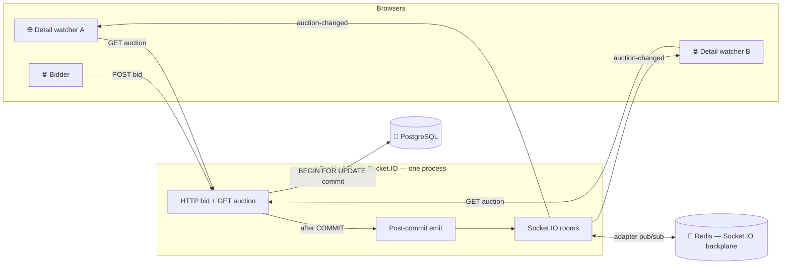

# GRILL.md — Part 4: Real-time Socket.IO + Redis

Agreed decisions from the design conversation. Glossary: [`CONTEXT.md`](./CONTEXT.md). ADRs: [`docs/adr/`](./docs/adr/).

## Locked decisions

| Topic | Decision |
| --- | --- |
| Baseline | Copy Part 3 into Part 4; preserve Part 3 transaction and locking rules |
| Scope | Auction detail pages only (no live catalog fan-out) |
| Infrastructure | One Redis server (Compose `redis` on `127.0.0.1:56379`) |
| Deployment | One application instance; no multi-replica demonstration |
| Process topology | Socket.IO is a logical role inside the Fastify process; Redis is the backplane |
| Subscription | Join a per-auction room by slug on detail mount; leave on unmount |
| Triggers | Emit only after an accepted bid commits; rejections do not emit |
| Publication | Emit auction-change events only after the bid transaction commits |
| Event contents | Small notification (`auctionSlug`, optional `reason`); fetch authoritative state via HTTP |
| Polling | Remove the 1s detail poll; refresh on socket ping, initial load, visibility, and reconnect |
| Emit failure | Bid stands if fan-out fails; log and rely on reconnect/visibility refresh |
| Recovery | Re-join room and refresh current state after reconnecting |
| Startup | Redis must be available before the application is ready |
| Socket auth | None; demo Active User stays on HTTP / sessionStorage |
| Correctness | Preserve Part 3 `FOR UPDATE` bid path unchanged aside from post-commit publish |

## Runtime

- Work only in `part-4-realtime-socketio-redis`
- Database `auction_part_4` on host port `55432`
- API `3104`, web `5104`
- Redis `redis://127.0.0.1:56379`
- Plain `pg` + ordered SQL migrations

## Architecture

## Implementation slices

1. **Live auction-detail updates** — Socket.IO + Redis in-process; per-auction rooms; post-commit notifications; browser join/leave + reconnect refresh; headed live-update verification; keep Part 3 concurrency tests green
2. *(Deferred until Slice 1 review)* Further realtime polish only if needed after browser verification

Slice 1 implemented — stop for browser review before any further slice.
