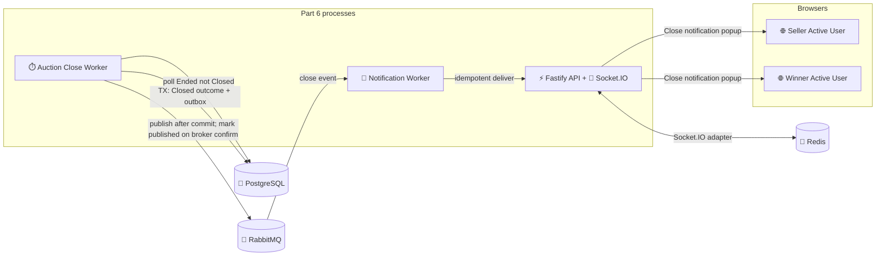

# GRILL.md — Part 6: Async close + RabbitMQ

Agreed decisions from the design conversation. Glossary: [`CONTEXT.md`](./CONTEXT.md). ADRs: [`docs/adr/`](./docs/adr/).

## Locked decisions

| Topic | Decision |
| --- | --- |
| Baseline | Copy Part 4 into Part 6; do not copy Part 5 (deliberate defect) |
| Bidding cutoff | Existing Closing time / **Ended** deadline remains authoritative for accepting Bids |
| Final outcome | A Close Worker durably records **Closed** plus Winner/Winning amount, or **Unsold** when there were no Bids |
| Reliable publication | Store the close outcome and outbox event in one database transaction ([ADR 0008](./docs/adr/0008-transactional-outbox-for-auction-close.md)) |
| RabbitMQ publication | Mark an outbox event published only after broker confirmation |
| Duplicate messages | Idempotent notification processing plus database uniqueness constraints |
| Recipients | Seller always; Winner when the Auction is not Unsold; document Unsold as the no-bid outcome |
| UI | Close notification popups that require explicit dismissal |
| Workers | Close Worker (poll → record outcome + outbox) is separate from Notification Worker (consume RabbitMQ → deliver Close notifications) |
| Coupling | Workers are bound through RabbitMQ, not by sharing a process |
| Scope deferred | Dead-letter queues and elaborate retry infrastructure |
| Realtime baseline | Preserve Part 4 Socket.IO + Redis bid fan-out and Part 3 `FOR UPDATE` bidding |

## Runtime

- Work only in `part-6-async-close-rabbitmq`
- Database `auction_part_6` on host port `55432`
- API `3106`, web `5106`
- Redis / RabbitMQ host ports finalized with part-local Compose during implementation (README targets: Redis `6306`, RabbitMQ `5606` / UI `15606`)
- Plain `pg` + ordered SQL migrations
- Exclude `node_modules` and generated output from the Part 4 copy

## Architecture

## No-bid outcome

When an Auction Ends with zero accepted Bids, the Close Worker still marks it **Closed** with outcome **Unsold** (no Winner, no Winning amount), writes the outbox event in the same transaction, and the Notification Worker notifies the **Seller** only.

## Implementation slices

1. **Durable close in the browser** — Close Worker polls Ended auctions; one transaction writes Closed + Winner/Unsold + outbox row; publish to RabbitMQ only after commit and mark published only after broker confirmation; API/UI expose Closed vs Ended and show Winner or Unsold on the detail page so the outcome is reviewable without relying on popups yet.
2. **Dismissible Close notification popups** — Notification Worker consumes RabbitMQ; idempotent processing with uniqueness constraints; deliver Close notifications to Seller and Winner (Seller only when Unsold) as WebSocket-driven popups that require explicit dismissal; headed browser check with Seller and Winner tabs.

Slice 1 approved. Slice 2 implemented — stop for browser review of dismissible popups.
