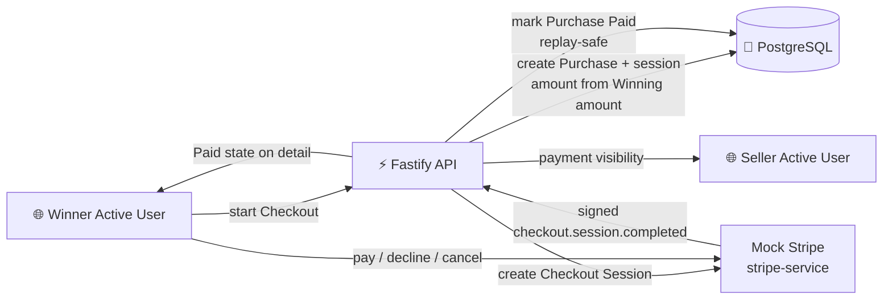

# GRILL.md — Part 7: Winner checkout

Agreed decisions from the design conversation. Glossary: [`CONTEXT.md`](./CONTEXT.md). ADR: [`docs/adr/0009-signed-webhook-is-payment-proof.md`](./docs/adr/0009-signed-webhook-is-payment-proof.md).

## Locked decisions

| Topic | Decision |
| --- | --- |
| Baseline | Copy Part 6 → `part-7-winner-checkout` from the main workshop (not the Drizzle worktree); remap to Part 7 ports/DB |
| Buyer | Only the Auction **Winner** may check out |
| Amount | Determined by the server from the recorded close outcome (**Winning amount**) |
| Payment proof | A valid signed webhook ([ADR 0009](./docs/adr/0009-signed-webhook-is-payment-proof.md)) |
| Duplicate webhooks | Must be replay-safe |
| Mock corrections | Allow minimal necessary fixes to the teaching `stripe-service` |
| Card scenarios | Success, decline, cancellation, and retry |
| Repeated clicks | Disable the button while starting checkout |
| Scope | Local mock only; no real Stripe account or API-key setup |
| Unsold | No Purchase / no checkout |
| Eligibility | Closed + Winner required; Ended-but-not-Closed is not payable yet |

## Runtime (planned)

- Work only in `part-7-winner-checkout` (+ minimal fixes in repo-root `stripe-service/`)
- Database `auction_part_7` on host port `55432`
- API `3107`, web `5107`, mock Stripe `7107`
- Redis / RabbitMQ / Jaeger part-local ports per README (`6307` / `5607` / `15607` / …)
- Keep Part 6 close + notification workflow

## Architecture

## Mock issues noted (teaching version)

Minimal fixes only as required for the decisions above: weak create idempotency after pay, missing already-complete attempt short-circuit, hosted form without `try/catch` on network errors. Defer unrelated polish unless a slice needs it.

## Implementation slices

1. **Winner checkout and authoritative paid state** — Copy Part 6 baseline into Part 7; Winner can start Checkout for a Closed Auction with a Winning amount; server creates/reuses a Purchase priced from the recorded outcome; mock session + payment page; signed webhook marks Paid replay-safely; success/decline/cancel/retry work; start button disables while checkout is starting; detail UI shows unpaid vs Paid for the Winner.
2. **Seller payment visibility and recovery** — Seller sees whether the Winner’s Purchase is unpaid or Paid; recovery path when payment did not complete (Winner can retry; Seller can tell unpaid vs Paid without guessing).

Slice 1 shipped. Slice 2 shipped (seller payment visibility, role-gated Purchase payloads, vanished-session recovery).
