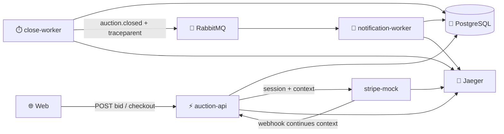

# GRILL.md — Part 8: Cross-stack observability

Agreed decisions from the design conversation. Glossary: [`CONTEXT.md`](./CONTEXT.md).

## Locked decisions

| Topic | Decision |
| --- | --- |
| Baseline | Copy Part 7 → `part-8-cross-stack-debugging`; remap to Part 8 ports/DB |
| Trace anchor | Winning Bid continues one tree through Close → messaging → notify → Checkout → mock pay → webhook → Paid; other accepted Bids stay short |
| Context persistence | W3C context on `bids`, then outbox / RabbitMQ headers / `purchases` (Slices 2–3) |
| PostgreSQL spans | Keep meaningful operation spans; scrub SQL text |
| Noise | Ignore health, routine GET auction/notification polls, Socket.IO, fs/dns/net auto-instrumentation |
| Attributes | IDs, amounts, roles, outcomes only — no names, handles, card data, raw payloads, SQL |
| Business outcomes | Stale bid / ended / decline / cancel → span status `Ok` + `outcome=…`; `Error` only for faults |
| UI | Traces in Jaeger only; no in-app tracing screen |
| Mock Stripe | Light OTel in Slice 3; browser OTel out of scope |
| Services | `auction-api`, `auction-close-worker`, `auction-notification-worker`, `stripe-mock` |

## Runtime

- Work only in `part-8-cross-stack-debugging`
- Database `auction_part_8` on host port `55432`
- API `3108`, web `5108`, mock Stripe `7108`
- Redis `6308`, RabbitMQ `5608` / UI `15608`, Jaeger UI `16608`, OTLP HTTP `4308`

## Architecture

## Implementation slices

1. **Jaeger pipeline + quiet API traces** — Part 8 from Part 7; part-local Jaeger; API exports OTLP as `auction-api`; noise filters + attribute scrubbing; Bid accept/reject paths record safe outcomes. Review in Jaeger after placing/rejecting a Bid.
2. **Winning-bid → close → notify chain** — Persist context on bids; instrument Close + Notification workers; RabbitMQ propagation; long tree from Winning Bid through durable notifications.
3. **Checkout → mock pay → Paid** — Purchase carries context; light `stripe-mock` OTel; webhook continues the same tree through Paid; decline/cancel as outcomes.

Slice 1 shipped (Jaeger + quiet API Bid traces). Slices 2–3 not started.
