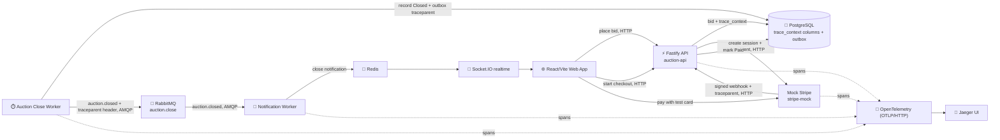

# GRILL.md — Part 8: Cross-stack observability

Agreed decisions for tracing one auction purchase end to end. Glossary: [`CONTEXT.md`](./CONTEXT.md). Payment proof: [`docs/adr/0009-signed-webhook-is-payment-proof.md`](./docs/adr/0009-signed-webhook-is-payment-proof.md). Browser walkthrough: [`GOLDEN_TRACE.md`](./GOLDEN_TRACE.md).

## Goal

When a Winner pays, an engineer can open one trace in Jaeger and follow the whole story:
**accepted Winning Bid → durable Close → publish → notify → Checkout → mock Stripe → Paid.**

## Locked decisions

| Topic | Decision |
| --- | --- |
| Propagation format | W3C `traceparent`, one global propagator (`otel.ts`) in every Node process |
| Durable boundaries | Context is stored, not held in memory: `bids.trace_context`, `purchases.trace_context`, outbox payload `traceparent`, AMQP header `traceparent`, HTTP `traceparent` + Checkout Session `metadata.traceparent` |
| Trace anchor | The accepted Winning Bid. Close, notify, checkout, and webhook continue its trace |
| Close lookup | Latest bid where `bidder_id = winner` and `amount = winning amount` |
| Unsold close | A fresh, short `auction.close.record` trace; no checkout follows |
| Rejected bids | Still recorded on the request span with `bid.outcome` and an **Ok** status — a stale or late bid is a business outcome, not an error |
| Declined card | `payment.outcome=declined` on the mock Stripe span, status Ok |
| Replayed webhook | `payment.outcome=replayed` on `purchase.mark_paid`, status Ok |
| Webhook trace source | Incoming `traceparent` header, falling back to `purchases.trace_context` |
| Safe attributes | IDs, slugs, amounts, roles, outcomes. Never names, handles, card data, SQL text, or message bodies (scrubbed at export) |
| Noise | Health, Socket.IO, routine `GET` reads, and the hosted checkout page are dropped before export |
| Mock Stripe | Telemetry is off unless `OTEL_EXPORTER_OTLP_ENDPOINT` is set, so other parts that share it are unaffected |
| Existing guarantees | Part 3 locking, outbox-after-commit, server-owned amount, signed webhook proof, replay safety all stay as they are |

## Runtime

- Work only in `part-8-cross-stack-debugging` (+ the shared `../stripe-service`)
- Database `auction_part_8` on host port `55432`
- API `3108`, web `5108`, mock Stripe `7108`
- Redis `6308`, RabbitMQ `5608` (UI `15608`), Jaeger UI `16608`, OTLP/HTTP `4308`
- Service names in Jaeger: `auction-api`, `auction-close-worker`, `auction-notification-worker`, `stripe-mock`

## Architecture

## Span map for the golden trace

| Span | Service | Continues from |
| --- | --- | --- |
| `POST /api/auctions/:slug/bids` (+ `bid.outcome=accepted`) | `auction-api` | trace root |
| `auction.close.record` | `auction-close-worker` | `bids.trace_context` of the Winning Bid |
| `auction.close.publish` | `auction-close-worker` | outbox `payload.traceparent` |
| `auction.close.notify` | `auction-notification-worker` | AMQP header `traceparent` |
| `auction.checkout` | `auction-api` | `bids.trace_context` of the Winning Bid |
| `POST /v1/checkout/sessions` | `stripe-mock` | `traceparent` header |
| `stripe.checkout.attempt` (`payment.outcome`) | `stripe-mock` | session `metadata.traceparent` |
| `stripe.webhook.deliver` | `stripe-mock` | session `metadata.traceparent` |
| `purchase.mark_paid` (`payment.outcome=paid`) | `auction-api` | webhook `traceparent` header / `purchases.trace_context` |

## Out of scope

Real Stripe, browser-side tracing, metrics and logs pipelines, sampling policy, and a hosted collector.
